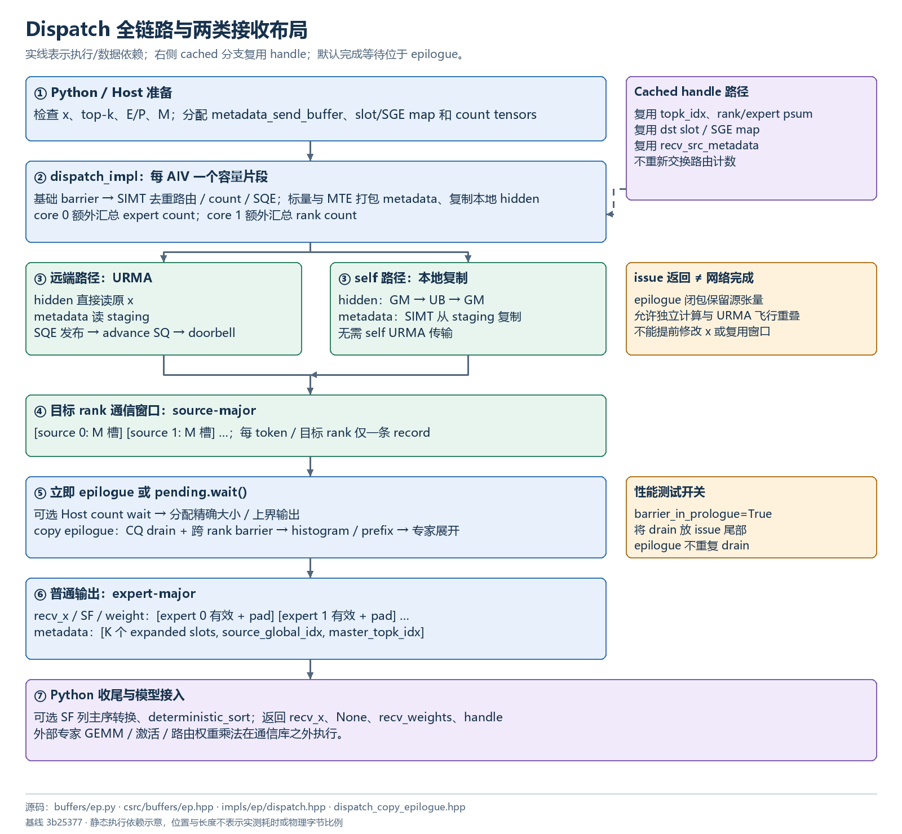
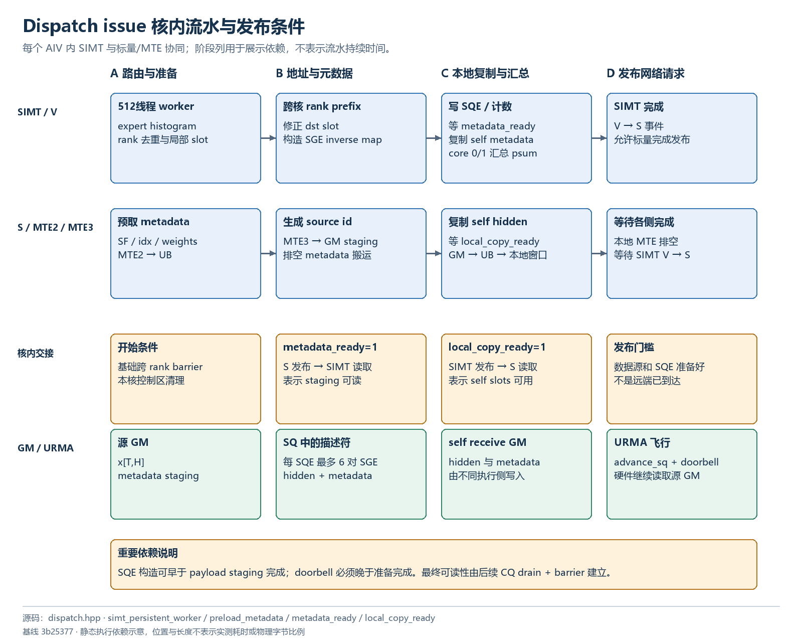
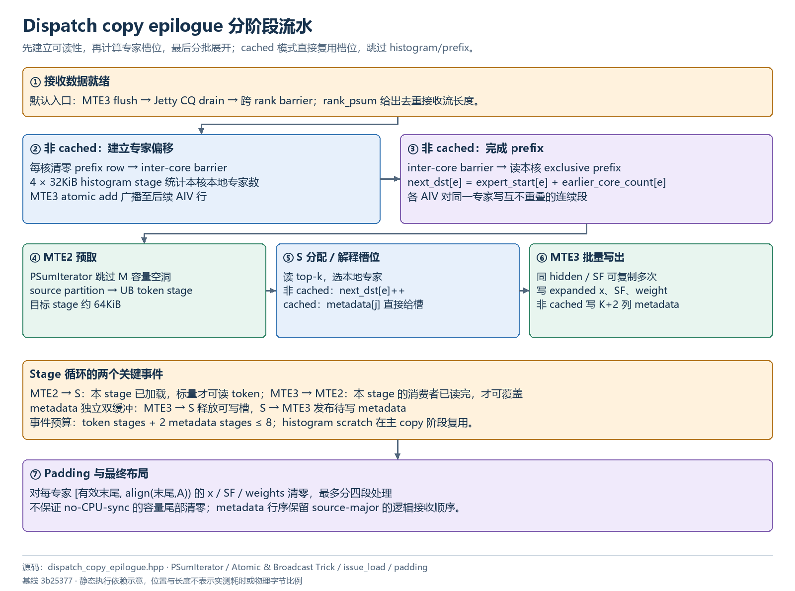

# Dispatch 执行流程

## 执行与布局图解

图中箭头表示代码依赖，阶段位置不代表实测时间；内存块不按字节比例。点击 SVG 链接可查看矢量原图。

### Dispatch 全链路与两类接收布局



[打开 SVG 矢量图](assets/dispatch-flow.svg) · [打开 PNG 原图](assets/dispatch-flow.png)

### Dispatch issue 核内流水与发布条件



[打开 SVG 矢量图](assets/dispatch-pipeline.svg) · [打开 PNG 原图](assets/dispatch-pipeline.png)

### Dispatch copy epilogue 分阶段流水



[打开 SVG 矢量图](assets/dispatch-epilogue.svg) · [打开 PNG 原图](assets/dispatch-epilogue.png)


## 输入输出与分工

记 P 为 rank 数，E 为总专家数，L=E/P，K 为 top-k，T 为实际输入 token 数，M 为每 rank 最大容量，V 为 AIV 数。专家 e 的 rank 为 `e//L`。同一 token 的多个专家若在同一 rank，只发送一份 hidden 和一份包含所有 top-k 的 metadata，接收端再展开。

一个 AIV 负责连续的输入容量片段，长度 `ceil(M/V)`，实际范围与 T 截断。它启动 512 线程 SIMT persistent worker，同时以标量/MTE 流水准备 metadata 和本地 hidden copy。多数 AIV 都参与发送与局部统计；core 0/1 额外承担全局专家/rank 计数汇总，不能照搬其他实现“单独 C 个计数核与 D 个发送核”的分法。

```text
dispatch_impl 基础 barrier
 ├─ SIMT worker：routing → histogram → prefix → slot/SGE → SQE
 │        └─ 发布 local_copy_ready，等待 metadata_ready
 └─ 标量/MTE：准备 metadata staging → 发布 metadata_ready
          └─ 等 local_copy_ready → 本地 hidden GM→UB→GM
 SIMT：复制本地 metadata，汇总远端计数与 psum
 标量等待 SIMT 完成 → advance SQ → doorbell
 [可选 benchmark drain]
      ↓ EventOverlap hook / 立即 epilogue
 [正常模式 drain + barrier]
 histogram → AIV 间 expert prefix → 接收数据分段搬入 UB
 → 按 expert 展开 → 写 metadata → padding
```

## 第一步 SIMT 路由与去重

`simt_persistent_worker` 先清理 UB histogram、SQE 计数、local-copy slot 与 inverse SGE map。非 cached 模式按最小覆盖 K 的 2 次幂划分 warp 内小组，例如 K=6 时每 token 8 lane。

每个有效 top-k lane 读取专家 e：若 e≥0，给 expert histogram 加一；再计算目标 rank，并在当前 token 的 routing group 内去重。去重后每个 rank 只保留一条发送 entry。其 `rank_histogram[rank]` 的 atomic-add 返回值就是该 AIV 发往该 rank 的局部 slot。

由此专家计数与 rank 计数不同：同 token 在同 rank 有两个专家时，expert 总数增加 2，rank 去重计数只增加 1。远端 entry 分配 SGE pair，本地 entry 记录 local copy slot。见 [deep_ep/include/deep_ep/impls/ep/dispatch.hpp:181](../deep_ep/include/deep_ep/impls/ep/dispatch.hpp)。

## 第二步 跨 AIV 前缀和与发送地址

各 AIV 将 local rank histogram 写入 workspace，其他核读取完成 tag 后，对同一目标 rank 的 AIV counts 求 exclusive prefix。最终 slot 等于：

```text
dst_slot(token,dst_rank)
  = sum(count[earlier_AIV,dst_rank]) + local_slot
```

这保证同一源 rank 的各 AIV 写目标 rank 的 source partition 时不重叠。源 rank 分区偏移为 `source_rank * M * token_bytes`，slot 在 `[0,M)` 内。

路由结果写入 handle 的 `[T,K]` `dst_buffer_slot_idx` 与 `dst_gsge_idx`。重复目标 rank、masked 项没有独立 slot/SGE；本地 copy 的 SGE 为 -1。cached 模式直接读取这两张表重建 inverse SGE mapping，跳过路由统计及远端计数交换。

## 第三步 metadata 流水与本地 copy

非 cached metadata 包含 scale packs、topk_idx、topk_weights 和 `src_global_idx=source_rank*M+token_idx`；cached 仅重新运输 scale 和 weights，原路由与 source metadata 从 handle 复用。

标量/MTE 分批将 metadata 搬进 UB，补入 global index，再 MTE3 写入 `metadata_send_buffer`。stage 大小依 UB 预算选择每批 64 或 4 token，metadata stage 最多 8；hidden stage 使用剩余 UB，最多 8。

FP8 scale 行主序走二维 burst，列主序走 NDDMA stride 描述。metadata 完成后发布 UB 标志 `metadata_ready`。SIMT 在该标志之后将 self-rank metadata 复制到本地接收窗口。hidden 的 self-rank 路径由 MTE2 GM→UB、MTE3 UB→本地接收窗口完成，不走远端 URMA。

`local_copy_ready` 与 `metadata_ready` 是核内两个执行侧的生产消费关系；它们不是远端 payload-ready 标志。见 [deep_ep/include/deep_ep/impls/ep/dispatch.hpp:688](../deep_ep/include/deep_ep/impls/ep/dispatch.hpp)。

## 第四步 构造 SQE 与发布

每条发送 entry 提供两段源地址：原始 x 中的 hidden，以及 metadata staging。默认一条 SQE 最多含 6 个 SGE pair，因而最多 12 个 SGE：

```text
48B SQE header + 12 * 16B SGE = 240B
固定预留 4 * 64B WQEBB = 256B / SQE slot
```

一条 SQE 将多段 hidden+metadata 写入同目标 rank 的连续 record slots。header 指定远端起点；每个 pair 描述一条 record 的两段源数据。未填满 slot 的剩余 WQEBB 使用相应 NOP 处理，避免队列解释错误。最后物理 SQE 请求 strong order 与 CQE。

SIMT 用 bypass store 写 SQ，标量等待 metadata、本地 copy、SIMT 完成后 `advance_sq` 并 ring doorbell。该主路径不是每写一个 token 就敲一次 doorbell。SQ 容量上界、16 位索引和 4 WQEBB 对齐均有断言。见 [deep_ep/include/deep_ep/impls/ep/dispatch.hpp:357](../deep_ep/include/deep_ep/impls/ep/dispatch.hpp)、[deep_ep/include/deep_ep/impls/ep/dispatch.hpp:853](../deep_ep/include/deep_ep/impls/ep/dispatch.hpp)。

## 第五步 计数交换与两个 psum

专家 histogram 在本 rank 聚合 V 个 AIV 的贡献，core 0 向负责专家的目标 rank 原子累加。目标 rank 等 P 个源 rank 到达，记录实际 count，并可累加到 `cumulative_local_expert_recv_stats`。rank histogram 则将每源 rank 的去重发送总数散布到目标，core 1 汇总。

状态是 32 位整型：高 8 位为 arrival count，低 24 位为 value。原子加可同时累计“来了几份”和“有多少 token”。因此必须限制 arrival≤255、value≤2²⁴−1，不能因公共数组容量为 256 ranks 就声称该 dispatch 支持 EP256。

专家 count 为 `c[e]`，则：

```text
expert_start[e] = Σ(j<e) align(c[j],A)
expert_psum[e]  = expert_start[e] + c[e]       # 有效末尾
physical_end[e] = align(expert_psum[e],A)     # padding 后末尾
rank_psum[r]   = Σ(s≤r) deduplicated_recv_count[s]
```

Host count 通知中的每专家值是 `align(c[e],A)`；Python list 因此是补齐后的分配长度，而 `num_unaligned_recv_tokens_per_expert` 是有效数量。见 [deep_ep/include/deep_ep/impls/ep/dispatch.hpp:505](../deep_ep/include/deep_ep/impls/ep/dispatch.hpp)。

## 第六步 Copy epilogue

正常模式先 drain 所有活动 Jetty，并经跨 rank barrier 确保来源完成，才能读窗口。然后使用 `rank_psum` 将“每源 rank 固定 M 容量窗口”遍历成无空洞的逻辑接收流。`PSumIterator` 把全局流位置映射回 source-rank partition，批次不跨当前连续分区。

非 cached 时，各 AIV 对其负责接收流重新计算本地专家 histogram；UB histogram 采用 4 个 32768B stage。每核先清空 workspace 的 prefix row，barrier 后以 atomic MTE3 将自己的 count 广播累加到所有后续 AIV 的行，形成 exclusive prefix，再加全局 expert_start。这样每 AIV 给某专家分配连续且互不冲突的输出槽位。

主 copy 流水采用目标约 64KiB 的 token stage 和两个 metadata stage，stage 数还受 UB 与事件数量限制。每条接收 token 逐个 top-k 检查专家是否属于本 rank；属于就将同一 hidden/SF 写到相应 expanded 行，并写该 j 对应的 weight。

同时为每条去重接收 token 生成一行 int32 metadata：

```text
[expanded_slot_for_topk_0, ..., expanded_slot_for_topk_K-1,
 source_global_idx, master_topk_idx]
```

不属于本 rank 的槽位为 -1；master 为属于本 rank 的最后一个 top-k 下标。这个 master 决定 combine 的 partial 写到哪个槽组，不是“主专家”。cached 路径直接复用 metadata 的 expanded slots，不再 histogram、分配槽或重写 metadata。见 [deep_ep/include/deep_ep/impls/ep/dispatch_copy_epilogue.hpp:398](../deep_ep/include/deep_ep/impls/ep/dispatch_copy_epilogue.hpp)、[deep_ep/include/deep_ep/impls/ep/dispatch_copy_epilogue.hpp:463](../deep_ep/include/deep_ep/impls/ep/dispatch_copy_epilogue.hpp)。

最后 `do_zero_padding` 将每专家有效末尾至对齐末尾的 x、weights、SF 清零；每专家 padding 可拆为最多四段处理。全容量尾部与无效 metadata 行没有由此获得全局清零保证。

## 性能设计的含义

rank 去重减少跨网重复 hidden；SGE 从 x 直接读减少全量发送打包；本地 copy 避免 self 网络往返；SIMT 与标量/MTE 并行准备不同内容；cached 路径省去路由与布局重建；deferred epilogue 给外部计算留下 URMA 飞行窗口。这些是源码表达的设计意图，实际收益取决于路由分布、HBM/网络争用和硬件栈。
