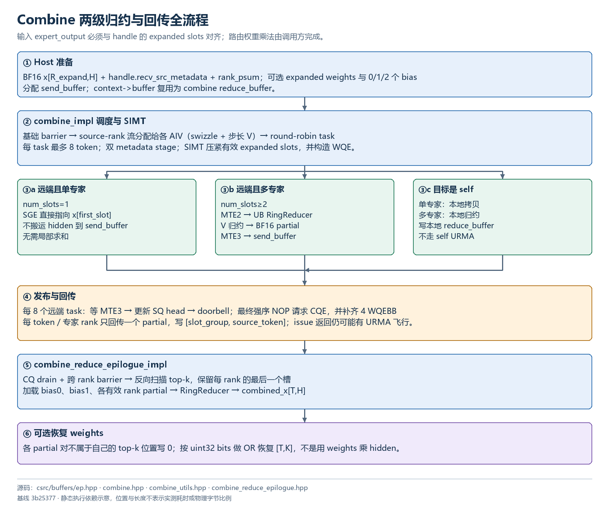
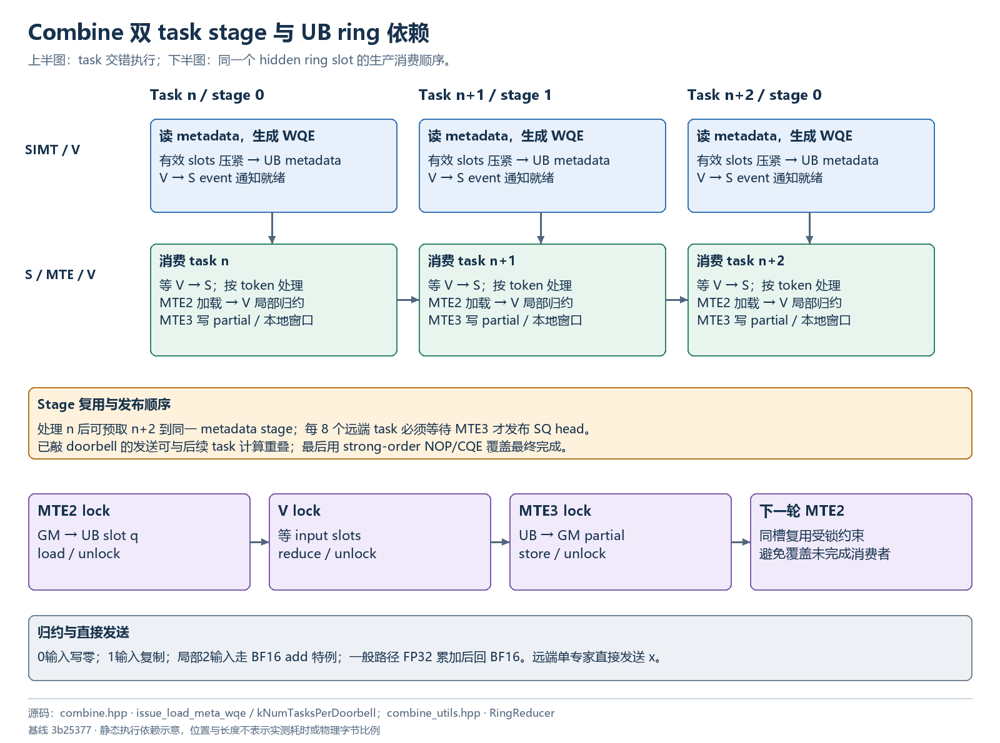

# Combine 执行流程

## 执行与布局图解

图中箭头表示代码依赖，阶段位置不代表实测时间；内存块不按字节比例。点击 SVG 链接可查看矢量原图。

### Combine 两级归约与回传全流程



[打开 SVG 矢量图](assets/combine-flow.svg) · [打开 PNG 原图](assets/combine-flow.png)

### Combine 双 task stage 与 UB ring 依赖



[打开 SVG 矢量图](assets/combine-pipeline.svg) · [打开 PNG 原图](assets/combine-pipeline.png)


## 两级归约的数学语义

对于源 token t，令 `J_r(t)` 为 top-k 中位于专家 rank r 的槽位集合，专家输出（应已按模型要求乘权）为 y：

```text
partial_r(t) = BF16_reduce({ y(t,j) | j∈J_r(t) })
output(t)    = BF16_reduce(bias0(t), bias1(t), 各有效 partial_r(t))
```

每个 token 每个专家 rank 只回传一个 partial；因此 slot 组数只需 `min(P,K)`。局部归约输出已经舍入为 BF16，再最终归约，不能把它当成所有专家输出一次 FP32 sum。见 [deep_ep/include/deep_ep/impls/ep/combine_utils.hpp:15](../deep_ep/include/deep_ep/impls/ep/combine_utils.hpp)。

## Host 准备

C++ 检查 x 为二维 contiguous BF16，metadata 为 `[R_recv,K+2]` int32，原 topk 为 `[T,K]` int64，rank psum 为 `[P]` int32，bias 形状为 `[T,H]`。若传 weights，则它为 `[R_expand]` FP32。

`send_buffer` 按 metadata 分配行数 R_alloc 申请 `R_alloc*(2H+align(4K,32))` 字节。no-CPU-sync 时 R_alloc 可能等于 P*M，即使实际通信行更少。对称 `context->buffer` 作为 reduce_buffer，与 dispatch 窗口复用。

## Task 调度

`combine_impl` 采用 `kNumTokensPerTask=8`、`kNumStages=2`、`kNumTasksPerDoorbell=8`。

每个源 rank 的接收流由 rank psum 确定，AIV 以步长 V 分配条目，起点经过 swizzle：

```text
start = (aiv_idx + src_rank * ceil(V/P)) % V
第 i 个条目 = recv_begin[src_rank] + start + i*V
```

这让不同源 rank 的流量分散到不同 Jetty。`Bitset active_ranks` 跟踪尚有任务的 rank，按错开的 round-robin 顺序每次取最多 8 个 token。一个 task 属于一个源 rank，其 token 的逻辑行不一定连续，而是相隔 V。见 [deep_ep/include/deep_ep/impls/ep/combine.hpp:224](../deep_ep/include/deep_ep/impls/ep/combine.hpp)。

## SIMT 读取映射与构造 WQE

`load_meta_issue_wqe` 每 token 一个 warp，读取 metadata 的 K 个 expanded slots、source_global_idx、master_topk_idx。通过 ballot/popcount 将非负 slots 紧凑写入 UB，并在 UB 行末记录 num_slots。

可选 weights 按原 top-k 位置放入 K 维尾部：属于本 rank 的 j 写 expanded weight，其他位置写 0；padding weight 元素也写 0。这些值服务最终恢复，不乘到 hidden 上。

远端任务每个 token 构建一条 WQE：48B header、两个 16B SGE，共 80B，占 2 个 64B WQEBB。hidden 源地址有两种：

| 本 rank 对该 token 的专家数 | hidden 来源 | 本地计算 |
| --- | --- | --- |
| 1，远端目标 | 直接指向 `x[first_slot]` | 无需 hidden staging 和局部求和 |
| ≥2，远端目标 | `send_buffer[recv_row]` | 先局部归约并写入 staging |
| 1，本地目标 | 本地 reduce_buffer | MTE2/MTE3 搬运一次 |
| ≥2，本地目标 | 本地 reduce_buffer | 局部归约后直接写入 |

第二个 SGE 指向 weights 尾部。即使没有请求返回 weights，record 布局仍保留尾部空间，但最终不读取其值，不能假设这些字节都是有效初始化数据。

目标地址为：

```text
remote_workspace_base + reduce_buffer_offset
 + (slot_group*M + source_token_idx)*combine_record_bytes
slot_group = (P<K) ? 当前专家rank : master_topk_idx
source_token_idx = source_global_idx - 源rank*M
```

P<K 时按专家 rank 放 partial；P≥K 时按该 rank 在原 top-k 中的最后一槽放 partial。见 [deep_ep/include/deep_ep/impls/ep/combine.hpp:99](../deep_ep/include/deep_ep/impls/ep/combine.hpp)。

## RingReducer 与流水

UB 除 metadata 两级 stage、peer/Jetty 描述与任务状态外，其余空间划为 hidden 环形槽，最多 32 个。`asc_lock/unlock` 将 MTE2 加载、V 归约和 MTE3 写回限制在同一槽的正确顺序，避免 buffer 在写出完成前被下一次加载覆盖。

多输入路径用 `load_first_2_token` 合并前两条搬运，再加载剩余 slots；归约将结果放到最近加载的最后槽。0 输入写零，1 输入复制；恰好 2 输入且 stride 等于 H 的局部路径使用 BF16 vector add；一般路径转为 FP32 累加，最后 round-to-nearest 回 BF16。因此“全部 combine 都 FP32 累加”并不准确。

两级 task metadata 预取与当前 task hidden 归约交错进行。每完成 8 个远端 task，等待 MTE3 写 staging 完成后更新 SQ head 并敲 doorbell，支持网络发送与后续 task 归约重叠。

结束时 append strong-order NOP 并请求 CQE，把最终 head 对齐到 4 WQEBB，再敲最后一次 doorbell。这与 dispatch 的“最后物理数据 SQE 请求 CQE”不同。正常模式最终排空发生在 reduce epilogue。见 [deep_ep/include/deep_ep/impls/ep/combine.hpp:342](../deep_ep/include/deep_ep/impls/ep/combine.hpp)。

## Reduce epilogue

`combine_reduce_epilogue_impl` 正常先执行 drain/barrier，随后各 AIV 负责原 T 个 token 的连续片段，并旋转本核读取顺序以错开访问。

每 token 逆序扫描原始 topk_idx，通过 seen-ranks bitset 保留每个 rank 的最后一个 top-k 槽，建立 master mask。这必须与 dispatch epilogue 写入的 master_idx 一致。再按顺序加载 bias0、bias1、各 master partial，经 RingReducer 得到输出。

若 token 全部 top-k 为 -1，则没有 partial：无 bias 输出零，有 bias 输出 bias 的归约。所有读取范围由 topk mask 确定，因此无需把整个 reduce_buffer 预清零，但路由和 handle 不能错配。

最终可选 weights 通过 `restore_combine_weights` 对不同 rank partial 的 uint32 bit pattern 做 OR。每个 j 只归属于一个专家 rank，其他 rank 对应位置为 0，因此 OR 可以精确恢复 FP32 bits；这里不是数值加权或浮点求和。对无效 j 返回 0，与测试把 masked weight 置 0 的契约一致。见 [deep_ep/include/deep_ep/impls/ep/combine_reduce_epilogue.hpp:20](../deep_ep/include/deep_ep/impls/ep/combine_reduce_epilogue.hpp)。

## 使用时的三个常见错误

* 专家输出被重新排列却没有同步 metadata：combine 用旧 slot 读到其他 token 的行，形状正常也可能结果错误。
* weights 只作为 combine 参数传入却未应用到专家输出：得到未加权的专家和。
* 按一次全局 FP32 sum 构造逐位参考：忽略了局部 BF16 partial 与最终 BF16 输出的舍入层级。

`deterministic=True` 管理的是 dispatch 行排列；它不会取消两级数值归约，也不会使任意不同计算图获得相同舍入结果。
