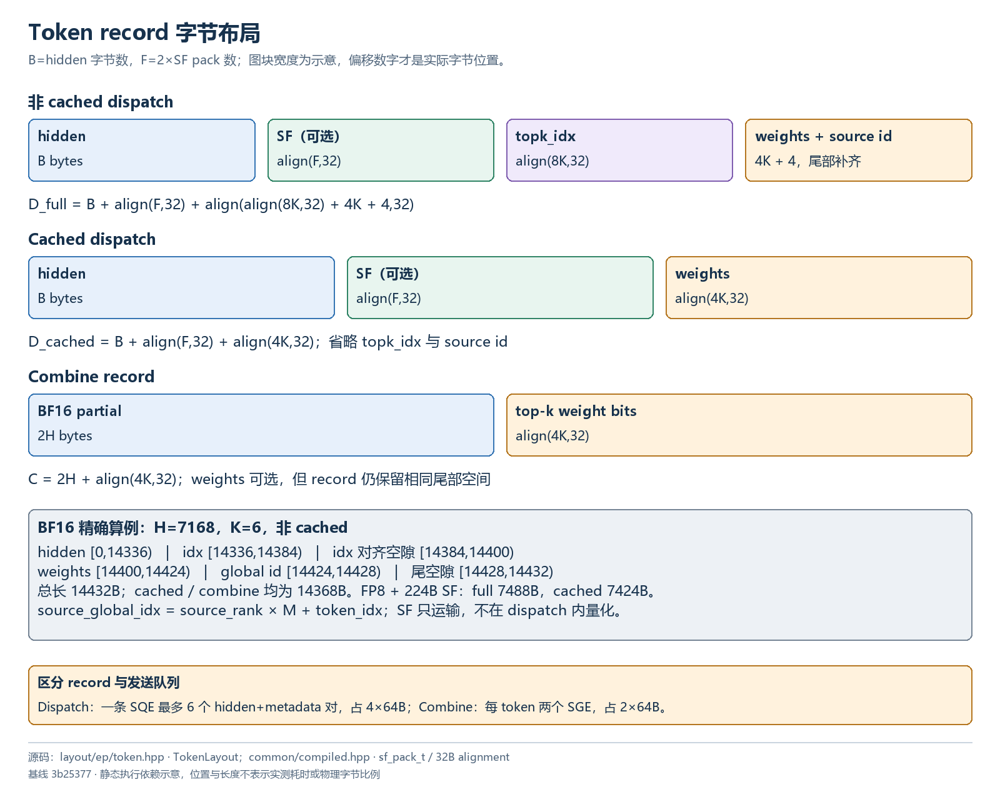
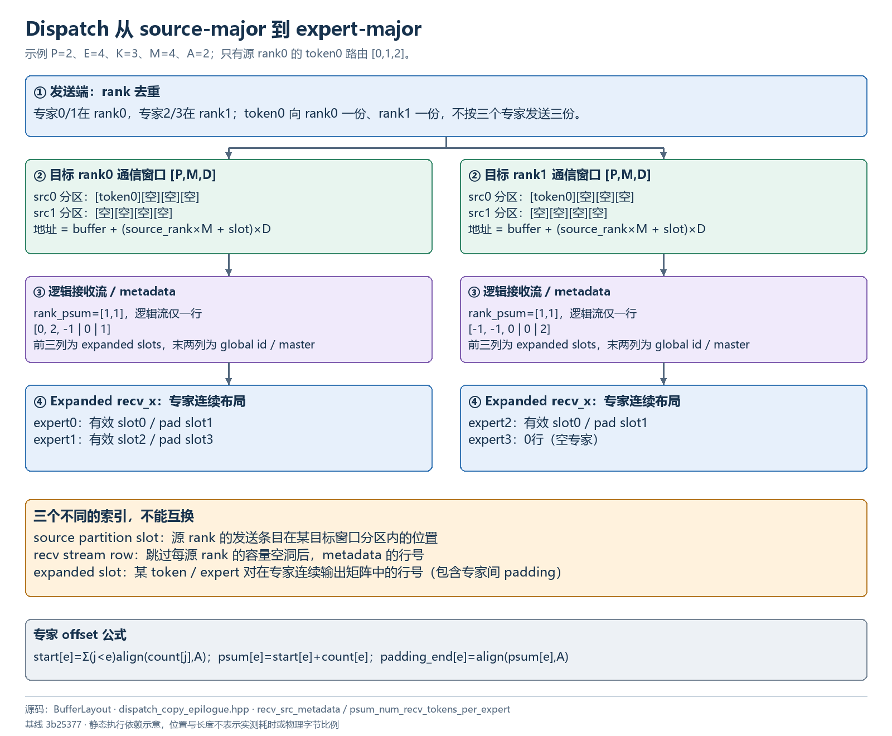
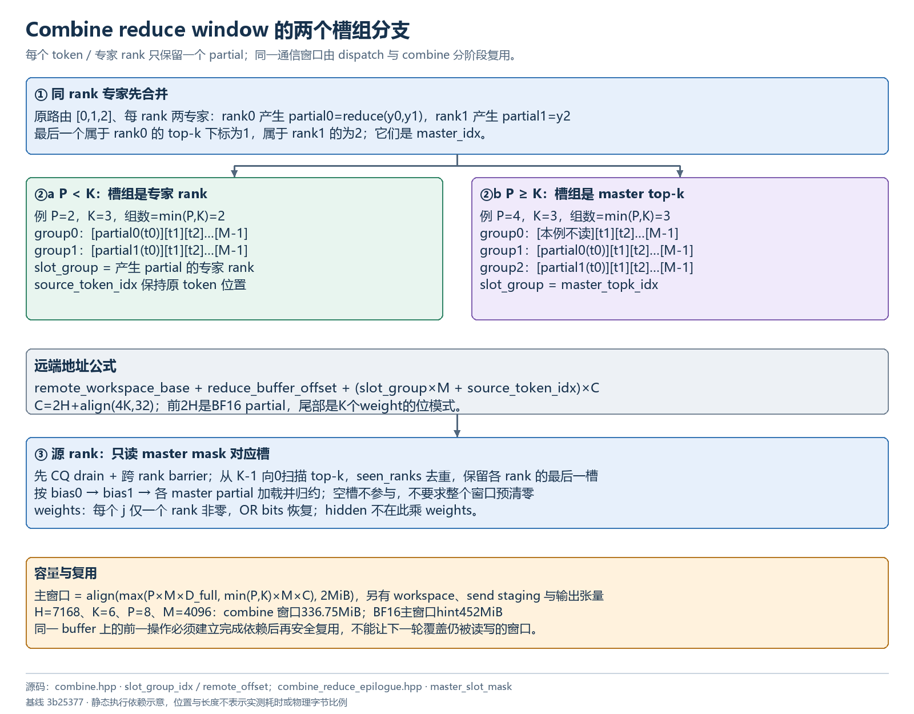

# 内存布局与算例

## 执行与布局图解

图中箭头表示代码依赖，阶段位置不代表实测时间；内存块不按字节比例。点击 SVG 链接可查看矢量原图。

### Token record 字节布局



[打开 SVG 矢量图](assets/token-records.svg) · [打开 PNG 原图](assets/token-records.png)

### Dispatch 从 source-major 到 expert-major



[打开 SVG 矢量图](assets/dispatch-layout.svg) · [打开 PNG 原图](assets/dispatch-layout.png)

### Combine reduce window 的两个槽组分支



[打开 SVG 矢量图](assets/combine-layout.svg) · [打开 PNG 原图](assets/combine-layout.png)

### 四个 kernel 的 UB 分区与空间复用


[打开 SVG 矢量图](assets/ub-layouts.svg) · [打开 PNG 原图](assets/ub-layouts.png)


## 符号与地址空间

| 符号 | 含义 |
| --- | --- |
| P、E、L | rank 数、总专家数、每 rank 专家数 E/P |
| T、M | 本地实际 token 数、所有 rank 约定的最大 token 数 |
| H、K、A | hidden 元素数、top-k、专家对齐粒度 |
| S、F | scale pack 数、scale 字节数 F=2S |
| B | hidden 字节数，BF16 为 2H，FP8 为 H |
| align(x,n) | 向上对齐到 n 的倍数 |
| V | 本次使用的 AIV 数 |

GM 包含输入输出张量、对称通信窗口、send staging、handle metadata；UB 是每个 AIV 独立的片上空间；host workspace 是设备映射的 CPU 内存。不要把 UB（Unified Buffer）与 UBMEM（通信协议/远端可达路径）混为一谈。

## 对称分配的总布局

```text
SymmetricMemory::ptr = workspace
  +0                         EPSignals（sizeof，2MiB 对齐）
  +num_workspace_bytes       context->buffer
       [dispatch 窗口 或 combine reduce 窗口，复用同一块]
       [可选 LB storage]
  +num_gpu_buffer_bytes      local_rdma_storage_ptr（EP 此处无额外容量）
```

总申请逻辑长度为 `workspace_bytes + align(gpu_buffer_bytes + rdma_storage_bytes, 2MiB)`。EP 的 gpu_buffer_bytes 含主 buffer 和 LB。`get_buffer_size_hint()` 返回主窗口大小，不包含 workspace、host workspace、普通 PyTorch 张量、send staging 和底层通信队列。见 [csrc/kernels/comm/api.hpp:16](../csrc/kernels/comm/api.hpp)。

通过 `get_sym_ptr` 做远端字段寻址：`remote_common_base + (local_field - local_common_base)`。HCCL/HCOMM 注册的是整个对称分配，因此窗口偏移也相对于 workspace 基址构造。

## Dispatch TokenLayout

假设 hidden 字节数满足搬运对齐约束，非 cached 记录为：

| 字段 | 相对 record 字节偏移 | 有效长度 |
| --- | --- | --- |
| hidden | 0 | B |
| sf packs | B（有 SF 时） | F，物理占 `align(F,32)` |
| topk_idx | `B+align(F,32)` | 8K，后补到 `align(8K,32)` |
| topk_weights | `B+align(F,32)+align(8K,32)` | 4K |
| source global index | 上一项起点 +4K | 4 |
| 尾 padding | global index 后 | metadata 总长度补到 32B |

```text
D_full = B + align(F,32) + align(align(8K,32) + 4K + 4,32)
D_cached = B + align(F,32) + align(4K,32)
C = 2H + align(4K,32)      # combine record
```

F=0 时 SF 段长度为零。cached 不再运输 index/global id；Host 的容量检查与 metadata staging 分配仍按完整 record 做保守估算，设备按 cached 布局解释。源码 `TokenLayout` 的 hidden 偏移假设对齐，不能由公式推导出任意 H 都合法。见 [deep_ep/include/deep_ep/layout/ep/token.hpp:9](../deep_ep/include/deep_ep/layout/ep/token.hpp)。

H=7168、K=6 时：

| record | hidden | scale | metadata/weights | 总字节 |
| --- | ---: | ---: | ---: | ---: |
| BF16 dispatch 非 cached | 14336 | 0 | 96 | 14432 |
| BF16 dispatch cached | 14336 | 0 | 32 | 14368 |
| FP8 dispatch 非 cached，128 分组 scale | 7168 | 224 | 96 | 7488 |
| FP8 dispatch cached，同上 | 7168 | 224 | 32 | 7424 |
| BF16 combine | 14336 | 0 | 32 | 14368 |

BF16 非 cached record 的精确字段为 hidden `[0,14336)`，idx `[14336,14384)`，idx 对齐空隙 `[14384,14400)`，weights `[14400,14424)`，source id `[14424,14428)`，尾空隙 `[14428,14432)`。这不是 480B/32B flag 交织格式。

## Dispatch 窗口与接收输出是两种布局

在目标 rank 上，通信窗口地址为：

```text
buffer + (source_rank*M + source_local_slot)*D
```

形状概念上是 `[P,M,D]`，source partition 内前 `count[source]` 条有效，剩余为容量。逻辑 recv stream 按 source-rank 顺序拼接各有效前缀，用 rank psum 跳过容量空洞。

最终 recv_x 是 expert-major 的普通连续矩阵，每专家有效行之后有 padding。通信窗口的 source_local_slot 不是 expanded slot；handle 负责维护映射。

```text
窗口：[src0 的 M 槽][src1 的 M 槽] ... [srcP-1 的 M 槽]
             ↓ 跳空洞形成逻辑接收流
metadata：[recv0][recv1] ... [recvR-1]，每行 K+2 个 int32
             ↓ 按本地专家展开
recv_x：[expert0有效|padding][expert1有效|padding] ...
```

## EPHandle 张量

| 字段 | dtype / shape | 含义 |
| --- | --- | --- |
| `topk_idx` | int64 `[T,K]` | 保留原路由引用，combine 和 cached 必需 |
| `dst_buffer_slot_idx` | int32 `[T,K]` | 发往目标 rank 的 source partition slot，去重/无效为 -1 |
| `dst_gsge_idx` | int32 `[T,K]` | AIV 内 SGE pair 序号；本地/去重/无效为 -1 |
| `psum_num_recv_tokens_per_rank` | int32 `[P]` | 每源 rank 去重接收数 inclusive sum |
| `psum_num_recv_tokens_per_expert` | int32 `[L]` | expert_start + 当前有效 count |
| `num_unaligned_recv_tokens_per_expert` | int32 `[L]` | 实际专家数 |
| `recv_src_metadata` | int32 `[R_alloc,K+2]` | K 个 expanded slot、global source id、最后 local top-k 下标 |
| `num_recv_tokens_per_expert_list` | Python list | CPU sync 时每专家补齐长度；无 sync 可为空 |

未同步 Host 时 Python `num_recv_tokens/num_expanded_tokens` 是分配容量，不一定是真实数量。deterministic 模式还保留排序前 metadata 的副本，并重写当前 metadata 的 expanded slots。

## Combine 窗口

概念形状为 `[min(P,K),M,C]`，每条 record 的前 2H 字节为 BF16 partial，后面 `align(4K,32)` 字节为 top-k weight bits。

P≥K 时槽组等于 master top-k 下标；P<K 时槽组等于产生 partial 的专家 rank。源 token 位置固定为原 token_idx，无需收齐后再次进行 token 排序。不同专家 rank 的 master 槽互异，从而避免写冲突。

窗口只填实际参与的槽；最终读取通过原路由的 rank 去重 mask 限定，空槽可以保留旧数据。不能绕开 metadata 对整个 `[min(P,K),M,H]` 盲目求和。

## EPSignals 布局

[deep_ep/include/deep_ep/layout/ep/workspace.hpp:8](../deep_ep/include/deep_ep/layout/ep/workspace.hpp) 定义：

| 字段 | 声明容量 | 用途 |
| --- | --- | --- |
| CommonSignals | peer_ptrs[256]、barrier/grid 状态 | 对称地址表与同步 |
| local_expert_histogram | `[2048][128]` int | 每专家独占 512B sector，降低同 sector 竞争 |
| remote_expert_histogram | `[2048]` int | 接收各 rank 专家计数归约 |
| local_rank_histogram | `[64][256]` int | 每 AIV 发往各 rank 的 count/前缀 |
| remote_rank_histogram | `[256]` int | 每源 rank 的接收 count |
| host_rank_expert_count | `[256+2048]` int | host 映射通知布局 |
| epilogue_expert_counter | `[64*2048]` int | 活动 `[V,L]` 行前缀计数，按 L 紧凑解释 |

结构整体 `alignas(2MiB)`。声明最大容量不是实际 kernel 支持范围；dispatch persistent worker 另有限制 E≤512，arrival count 也另有限制。

## UB 布局和阶段复用

* Dispatch issue：histogram/rank prefix、entry→rank/slot、SGE inverse map、Jetty/peer 描述、local-copy 标志；其后 metadata stage 与 hidden stage。metadata storage 与 hidden storage 分开，保护不同流水的生命周期。
* Dispatch epilogue：两份 expert state、4×32KiB histogram scratch；完成 histogram 后该空间复用为 token copy stage；另有两个 metadata stage 和零值 buffer。事件总数上限与 UB 容量共同限制 stage 数。
* Combine issue：Jetty/peer、remaining token、next recv slot、两级 8-token metadata；剩余划为最多 32 个 hidden ring slot。
* Combine epilogue：每 ring slot 为 hidden+weights record；需容纳 `min(P,K)+2` 个潜在输入，其中 +2 留给 bias。

UB 总量来自运行时设备查询，模板静态断言验证特定 H/K/P/M/V 组合。调大 M 或减小 V 会增大单核 entry 表及 SQ 需求，不能只检查总通信窗口容量。

## 容量计算实例

取 P=8、M=4096、H=7168、K=6，按源码公式计算：

| 项目 | 字节数 | MiB |
| --- | ---: | ---: |
| BF16 dispatch 主窗口 `P*M*14432` | 472907776 | 451 |
| 实际测试 FP8 SF 的 dispatch 窗口 | 245366784 | 234 |
| FP8 size hint 的保守 dispatch 窗口 | 252706816 | 241 |
| combine 窗口 `min(P,K)*M*14368` | 353107968 | 336.75 |
| BF16 hint：max 后按 2MiB 对齐 | 473956352 | 452 |
| FP8 hint：max 后按 2MiB 对齐 | 354418688 | 338 |

FP8 hint 用 `S=ceil(H/32)` 估算 SF pack 数，比测试的两个 int16/128 hidden 多一倍。该例 FP8 的最终主窗口由 combine 决定，所以并非 BF16 容量简单减半。

以均衡满 top-k 为例，本地平均 expanded 有效行约 `P*T*K/P=T*K=24576`，但不是每次都相等；no-sync 上界使用 M 与 `min(K,L)`，可能显著大于平均值。recv_x、metadata、send_buffer、weights、确定性排序临时内存均额外占用显存。该算例为公式演算，不是 allocator 或 NPU 的实测峰值。

## 可手工追踪的路由例子

取 P=2、E=4、L=2、K=3、M=4、A=2；仅用于解释索引（真实 kernel 的 H 等仍应满足断言）。rank0 部署专家0/1，rank1 部署专家2/3。设只有 rank0 的 token0 有路由 `[0,1,2]`，其余 token/rank 无有效路由。

dispatch 向 rank0 发送一份 token，向 rank1 发送一份，而不是三份。rank0 expert counts 为 `[1,1]`，expert starts 为 `[0,2]`，expert psum 为 `[1,3]`，补齐后的总输出为 4 行：有效行0和2，padding 行1和3。rank1 counts 为 `[1,0]`，starts 为 `[0,2]`，psum 为 `[1,2]`，总输出为2行。

| 接收 rank | metadata 的 K 个 slots | global id | master |
| --- | --- | ---: | ---: |
| rank0 | `[0,2,-1]` | `0*M+0=0` | 1 |
| rank1 | `[-1,-1,0]` | 0 | 2 |

combine 在 rank0 把专家0和1的结果局部相加得到 partial0；rank1 只有专家2，直接以其结果发送 partial1。P<K，所以两个 partial 分别写回源 rank0 的 group0/token0 与 group1/token0。最终 source rank0 加和这两个 partial，并可加入 bias。

若改为 P=4、E=8、K=3，同路由 `[0,1,2]` 仍落在 rank0 与 rank1，但 P≥K，partial0 写 master group1，partial1 写 master group2；group0 不参与。这个分支解释了为什么 reduce_buffer 的第一维既不能一概叫 rank，也不能一概叫 top-k。
